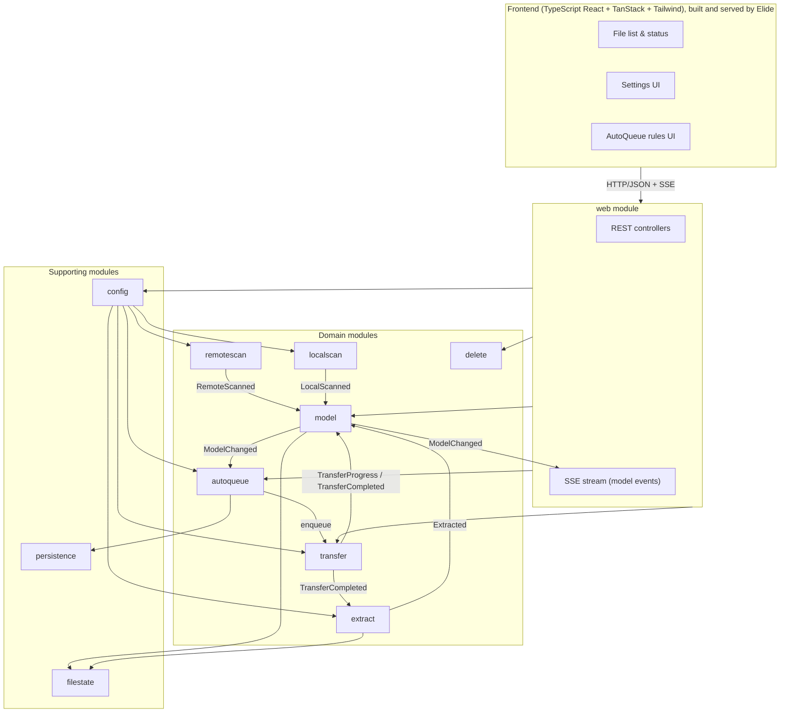

# SporeSync Specification

SporeSync is a feature-for-feature rewrite of [seedsync](https://github.com/nitrobass24/seedsync): a self-hosted tool that mirrors files from a remote seedbox to a local machine over SSH, with a web UI for browsing, queuing, extracting, and deleting files.

## Goals

- Reach parity with seedsync's user-facing features.
- Replace LFTP with a native SSH/SFTP transfer engine.
- Ship as a single Docker image with no runtime dependencies beyond the remote host having Python 3.
- Keep the codebase small, typed, and modular so it stays easy to maintain.

## Non-goals (v1)

- Authentication or multi-user support. SporeSync assumes a trusted network.
- Multiple remote hosts.
- Server-side rendering of the UI. Elide running the frontend toolchain makes SSR possible later, but v1 ships a static bundle.
- RAR5 extraction (no pure-JVM library exists; documented as unsupported).

## Stack

| Layer | Choice |
|-------|--------|
| Runtime | Elide (latest) as the single runtime: runs the Kotlin backend, runs the frontend toolchain (Vite build and dev server) through its JavaScript engine, and serves the built bundle. No Node.js anywhere. |
| Backend | Kotlin, Spring Boot, Spring Modulith |
| Persistence | H2 (file mode) via Spring Data JPA for rules, history, and settings cache |
| Tracked-file state | File-based marker files on disk (parity with seedsync) |
| SSH/SFTP | SSHJ |
| Archive extraction | Apache Commons Compress (zip, tar, gz, bz2, xz, 7z) and junrar (RAR4) |
| Remote scanner | Small Python 3 script copied to and executed on the remote host over SSH |
| Frontend | TypeScript (strict) + React, TanStack Router, TanStack Query, Tailwind CSS, built with Vite running on Elide |
| Live updates | Server-Sent Events (SSE) |
| Packaging | Docker image built on Elide |

## Architecture

### Module rules

- Each module is a top-level package under `com.sporesync`. Spring Modulith's `ApplicationModules.verify()` runs in the test suite and fails the build on illegal cross-module access.
- Modules communicate through Spring Modulith application events. The only direct dependencies allowed are on a module's explicitly exported API (for example `transfer` exposes `TransferQueue.enqueue(path)` and `delete` exposes `Deleter`).
- `model` is the hub. Scanners and workers publish facts into it; it owns the file state machine and publishes `ModelChanged` events outward.
- `config` is the only module that reads or writes the settings file. Other modules receive a typed settings object and subscribe to `ConfigChanged`.

### Module responsibilities

**config**
Reads and writes `settings.toml` (or `.yaml`; one format, decided in implementation). Validates on load and on save. Publishes `ConfigChanged`. Settings groups mirror seedsync: General (debug, verbose), Connection (host, port, username, auth method, key path or password), Paths (remote dir, local dir, remote scanner path), Transfer (concurrent file limit, per-file connection limit, bandwidth limit), Scan (remote interval, local interval), Extraction (enabled, delete archive after extract), AutoQueue (enabled, patterns-only mode).

**remotescan**
On a configurable interval, ensures the Python scanner script is present on the remote host (copy over SFTP if missing or out of date), runs it over SSH, parses its JSON output into a tree of remote files with sizes and modification times, and publishes `RemoteScanned`. Reports connection failures as a typed status the UI can show.

**localscan**
On a configurable interval, walks the local download directory and publishes `LocalScanned` with sizes and modification times.

**model**
Merges remote and local trees into one `ModelFile` tree. Each file has a state: `DEFAULT`, `QUEUED`, `DOWNLOADING`, `DOWNLOADED`, `EXTRACTING`, `EXTRACTED`, `DELETED_LOCALLY`, `DELETED_REMOTELY`. Tracks local size vs remote size, transfer speed, and ETA. Consults `filestate` to restore `DOWNLOADED` and `EXTRACTED` across restarts. Publishes `ModelChanged` with a diff (added, updated, removed) so the SSE stream and auto-queue only see deltas.

**filestate**
File-based record of which files have been downloaded or extracted, stored as marker files under a `.sporesync` directory inside the local download dir. Pure Kotlin, no database. This is deliberately file-based so the state survives a reset of H2 and matches seedsync behavior.

**transfer**
Native SFTP download queue built on SSHJ. Maintains a pool of SSH connections. Downloads up to N files concurrently (`concurrentFiles`), and splits each file into up to M byte-range segments downloaded over separate SFTP channels (`connectionsPerFile`). Supports resume by checking existing partial file size, pause/stop of an in-flight transfer, and a global bandwidth cap. Publishes `TransferProgress` (bytes, speed, ETA) at a throttled rate and `TransferCompleted` or `TransferFailed`.

**extract**
Subscribes to `TransferCompleted` and to explicit extract requests from the API. Detects archives by extension and magic bytes, including multi-part RAR sets and nested archives inside directories. Extracts with Commons Compress or junrar into the file's own directory. Publishes `Extracted` and records the result in `filestate`. Optionally deletes the archive afterwards per config.

**autoqueue**
Stores patterns in H2. On `ModelChanged`, queues any new remote file whose name matches a pattern (or every new file when patterns-only mode is off). Exposes CRUD for patterns.

**delete**
Deletes a file or directory locally, or remotely over SFTP. Publishes `DeletedLocally` / `DeletedRemotely` so `model` can update state.

**persistence**
Spring Data JPA entities and repositories for auto-queue patterns, transfer history, and a settings cache. H2 in file mode under `/config`. Liquibase manages schema.

**web**
REST controllers and the SSE endpoint. The SSE stream sends an initial full model snapshot then `ModelChanged` deltas, plus connection status and config changes. Static frontend assets are served by Elide from the same origin.

## REST API

All endpoints are JSON under `/api`. Paths are relative to the remote root directory and URL-encoded.

| Method | Path | Purpose |
|--------|------|---------|
| GET | `/api/stream` | SSE stream: `model.snapshot`, `model.changed`, `status`, `config` |
| GET | `/api/status` | Connection status, scan health, version |
| GET | `/api/config` | Current settings |
| PUT | `/api/config/{section}/{key}` | Update one setting; validation errors return 400 |
| POST | `/api/queue/{path}` | Queue a file for download |
| POST | `/api/stop/{path}` | Stop an in-flight or queued download |
| POST | `/api/extract/{path}` | Extract a downloaded archive |
| DELETE | `/api/local/{path}` | Delete locally |
| DELETE | `/api/remote/{path}` | Delete remotely |
| GET | `/api/autoqueue` | List patterns |
| POST | `/api/autoqueue` | Add pattern |
| DELETE | `/api/autoqueue/{id}` | Remove pattern |
| POST | `/api/restart` | Restart background services after a config change |

## Frontend

Single-page app in TypeScript with strict mode, no `any`. API types are generated from the backend OpenAPI document so request and response shapes are checked at compile time. Routes:

- `/` File list. Tree view with expand/collapse, filter by status and name search, sort by name/size/modified, per-file actions (queue, stop, extract, delete local, delete remote). Live progress bars and speed/ETA from the SSE stream. Shows connection status banner when the remote is unreachable.
- `/settings` Form grouped by settings section, saved per field with inline validation errors and a "restart required" notice.
- `/autoqueue` Pattern list with add and remove.
- `/about` Version and links.

TanStack Query holds the model cache; the SSE client applies deltas into the cache. TanStack Router handles routes. Tailwind for styling with a small set of shared components (Button, Badge, ProgressBar, Table, Form field). Dark mode via `prefers-color-scheme`.

## Remote scanner script

A single Python 3 file with no third-party dependencies. Invoked as `python3 scanner.py <dir>`. Walks the directory and prints one JSON document to stdout: a list of entries with relative path, size, mtime, and is_dir. The backend embeds the script as a resource, hashes it, and re-uploads when the remote copy's hash differs.

## Packaging and operations

- Dockerfile based on the Elide image. Build stage uses Elide to compile the Kotlin backend and to run the Vite build for the frontend; final image runs Elide with the backend and serves the bundle. No Node.js in any stage.
- Local development: `elide` runs the backend and the Vite dev server with hot reload; the dev server proxies `/api` to the backend.
- Volumes: `/config` (settings file, H2 data) and `/downloads` (local directory).
- Environment variables override settings file values using Spring's relaxed binding.
- Health endpoint at `/actuator/health`.
- Structured JSON logging with a debug toggle in settings.

## Code quality

- Backend: ktlint for formatting, detekt for lint. Both run in the build and fail on violations.
- Frontend: Prettier for formatting (check mode in CI), ESLint with TypeScript and React rules.
- CI runs six required checks on every PR: backend unit tests, backend format, backend lint, frontend unit tests, frontend format, frontend lint. Plus the Docker image build.

## Testing

- Unit tests per module with JUnit 5 and Kotest or plain JUnit assertions.
- `ApplicationModules.verify()` test for Modulith boundaries.
- Transfer and remotescan integration tests against an SSH server in Testcontainers.
- Extraction tests with fixture archives per format.
- Frontend component tests with Vitest and Testing Library; one end-to-end smoke test with Playwright against the Docker image.

## Milestones

1. **Skeleton**: repo layout, Elide build, Spring Modulith skeleton with empty modules and verify test, frontend scaffold, Docker image, CI.
2. **Core sync**: config, remotescan with Python script, localscan, model, filestate, transfer, web API and SSE, file list UI.
3. **Parity polish**: extract, autoqueue, delete, settings UI, autoqueue UI, status banner, integration and end-to-end tests, docs.

## Open questions

- Settings file format: TOML vs YAML. Lean TOML for readability.
- Whether per-file segmented downloads land in milestone 2 or 3. Parallel files land in 2 regardless.
